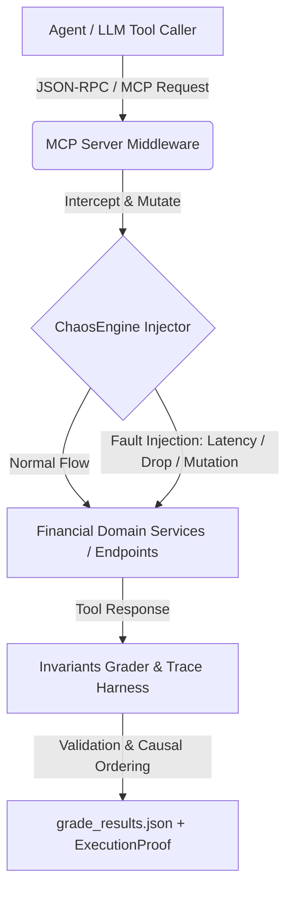

# 🚀 micro1-financial-eval
## Deterministic Benchmarking & Chaos Engineering Framework for Model Context Protocol (MCP) Financial Agents

[](https://github.com/raulrodriguezmesia-blip/micro1-financial-eval/actions)
[](https://github.com/raulrodriguezmesia-blip/micro1-financial-eval)
[](https://www.python.org/)
[](https://modelcontextprotocol.io)
[_Invariants-orange.svg)](https://github.com/raulrodriguezmesia-blip/micro1-financial-eval)
[](https://github.com/raulrodriguezmesia-blip/micro1-financial-eval/blob/main/Dockerfile)
[](https://github.com/raulrodriguezmesia-blip/micro1-financial-eval/blob/main/LICENSE)

---

## 📌 Executive Summary (BLUF)

**micro1-financial-eval** is a production-grade, deterministic evaluation framework engineered to benchmark Autonomous AI Agents and Model Context Protocol (MCP) servers operating within critical financial domains.

By injecting synthetic distributed system failures—such as transient disconnections, network jitter, clock drift, and mutated payloads—via an embedded **ChaosEngine**, the framework rigorously evaluates model resilience, state-machine integrity, and tool-calling determinism without relying on non-deterministic LLM-as-a-judge heuristics.

---

## 🏗 System Architecture & Telemetry Pipeline

The architecture strictly decouples the test harness, the ChaosEngine fault injector, the MCP server under test, and the invariant grader into isolated, highly inspectable components.



### Core Architecture Components

- **MCP Server Endpoint Layer:** 9 standardized router endpoints mirroring real-world transactional financial systems (e.g., balance check, wire transfer, portfolio rebalance).
- **ChaosEngine (`chaos.py`):** Configurable fault-injection engine featuring 6 distinct failure modes to test edge-case recovery and error propagation bounds.
- **Trace Harness (`harness.py`):** JSON-RPC 2.0 over stdio client and agent harness that intercepts tool calls and returns validated responses for grading.
- **Invariants Grader (`invariants.py`):** Hard-stop and soft-flag assertion engine validating state preservation, UUID checks, transaction limits, solvency verification, contract completeness, parse integrity, and idempotency.

---

## ⚡ ChaosEngine Fault Matrix

The embedded ChaosEngine tests model adaptability against realistic distributed systems degradations:

| Chaos Mode | Type | Target / Impact | Guardrail Defense |
|:---|:---|:---|:---|
| `SCHEMA_DRIFT` | Protocol | Mutates field types/names (e.g., `amount` string injection) | `PARSE_INTEGRITY` |
| `ARTIFICIAL_LATENCY` | Network | Delays response by custom thresholds (> 2000ms) | `TIMEOUT_CASCADE` |
| `TRUNCATED_RESPONSE` | Protocol | Cuts off required JSON balance payload keys | `CONTRACT_COMPLETENESS` |
| `FALSE_SUCCESS` | State | Returns `SUCCESS` flag with corrupted `TX_ID` or unverified state | `STATE_VERIFICATION` |
| `DECOY_ERROR` | API | Emits fake 500 exceptions to trick retry loops | `BOUNDED_RETRY` |
| `TIMEOUT_CASCADE` | Network | Simulates upstream gateway timeouts (504) | `NO_UNSAFE_RETRY` |

---

## 🧪 Test Suite & Coverage

The repository includes a **66-test suite** covering invariant verification, chaos mutations, harness orchestration, server tools, and end-to-end grading:

```bash
# Run unit & integration tests with coverage report
pytest --cov=grader --cov=mcp_server --cov-fail-under=90
```

**Coverage Results:**
| Module | Statements | Miss | Coverage |
|:---|:---:|:---:|:---:|
| `grader/grade.py` | 81 | 0 | 100% |
| `grader/harness.py` | 46 | 0 | 100% |
| `grader/invariants.py` | 65 | 0 | 100% |
| `mcp_server/chaos.py` | 85 | 1 | 99% |
| `mcp_server/server.py` | 56 | 2 | 96% |
| `mcp_server/__init__.py` | 0 | 0 | 100% |
| **TOTAL** | **333** | **3** | **99%** |

🐳 **Docker Execution**

To run the suite inside a fully isolated, non-root container environment:

```bash
# Build and run using Docker Compose
docker-compose up --build
```

⚙️ **CI/CD Pipeline** (`.github/workflows/eval-ci.yml`)

On every push or pull request touching the evaluation suite:
- Provisions Python 3.10 with cached dependencies
- Runs pytest and enforces the ≥ 90% coverage quality gate
- Executes the full benchmark suite (`grade.py`)
- Uploads coverage report artifacts (`htmlcov/`) and evaluation proofs (`grade_results.json`)

---

## 🗂️ Evaluation Tasks Matrix (`tasks/`)

The suite features 10 comprehensive evaluation scenarios:

| Task | Domain | Chaos Mode | What It Tests |
|:---|:---|:---|:---|
| `task_01` | Solvency & Boundary | NONE | $50,000 limit enforcement, UUID validation |
| `task_02` | Solvency & Boundary | NONE | Transaction limit breach detection (75,000 > 50,000) |
| `task_03` | Solvency & Boundary | NONE | FX balance insufficiency (4,000 > 3,000) |
| `task_04` | Schema Integrity | SCHEMA_DRIFT | Missing `toCurrency` field detection |
| `task_05` | Schema Integrity | NONE | Contract completeness for `get_balance` |
| `task_06` | Schema Integrity | TRUNCATED_RESPONSE | Truncated JSON payload detection |
| `task_07` | State Consistency | FALSE_SUCCESS | Reported success with corrupted state |
| `task_08` | State Consistency | NONE | Idempotency / duplicate request detection |
| `task_09` | State Consistency | DECOY_ERROR | Fake 500 error rejection |
| `task_10` | Distributed Fault | TIMEOUT_CASCADE | Upstream dependency timeout (504) |

---

## 🚀 Quick Start (Local)

### Installation

```bash
# Clone the repository
git clone https://github.com/raulrodriguezmesia-blip/micro1-financial-eval.git
cd micro1-financial-eval

# Create virtual environment & install dependencies
python3 -m venv .venv
source .venv/bin/activate  # On Windows: .venv\Scripts\activate
pip install -r requirements.txt
```

### Running the End-to-End Benchmark

```bash
chmod +x run_eval.sh
./run_eval.sh
```

Or directly with Python:

```bash
python -m grader.grade --tasks-dir tasks --output results/grade_results.json
```

### Running Tests

```bash
# Full test suite with coverage
pytest --cov=grader --cov=mcp_server --cov-fail-under=90

# Verbose output
pytest -v

# Specific test file
pytest tests/test_chaos.py -v
```

---

## 📊 Sample ExecutionProof Output

When the evaluation finishes, an audit log is exported to `results/grade_results.json`:

```json
{
  "task_id": "task_02",
  "status": "REJECTED",
  "execution_proof": {
    "validations_passed": ["UUID_CHECK", "TX_LIMIT_CHECK", "SOLVENCY_CHECK", "CONTRACT_COMPLETENESS", "PARSE_INTEGRITY", "IDEMPOTENCY_CHECK", "STATE_VERIFICATION"],
    "timestamp": "2026-10-30T06:30:00.123Z",
    "guardrail_triggered": true,
    "scenario_id": "NONE",
    "mode": "NONE"
  },
  "mutated_payload": {
    "success": false,
    "error": "REJECTED: El monto excede el límite de la política de tesorería.",
    "requestId": "550e8400-e29b-41d4-a716-446655440001",
    "amount": 75000.0
  },
  "error": null
}
```

---

## 🛠️ Project Structure

```
micro1-financial-eval/
├── .github/workflows/
│   └── eval-ci.yml           # GitHub Actions CI/CD workflow
├── agents/
│   └── reference_agent.py    # Reference agent interacting with adversarial MCP
├── grader/
│   ├── grade.py              # Main evaluation orchestrator & runner
│   ├── harness.py            # MCP stdio Client & Agent Harness
│   └── invariants.py         # O(1) Zero-Hallucination rules & ExecutionProof
├── mcp_server/
│   ├── __init__.py           # Package init
│   ├── chaos.py              # ChaosEngine with 6 mutation algorithms
│   ├── scenarios.json        # Scenario definitions & chaos configs
│   └── server.py             # FastMCP financial tool server
├── tasks/                    # Task definitions (task_01.yaml -> task_10.yaml)
├── tests/                    # Unit and integration tests (66 passed, 99% coverage)
│   ├── test_chaos.py
│   ├── test_chaos_extra.py
│   ├── test_chaos_final.py
│   ├── test_grade.py
│   ├── test_grade_extra.py
│   ├── test_grade_coverage.py
│   ├── test_grade_final.py
│   ├── test_harness.py
│   └── test_invariants.py
│   └── test_server.py
├── .gitignore
├── Dockerfile                # Multi-stage non-root container configuration
├── docker-compose.yml        # Multi-service network composition
├── README.md                 # Project documentation
├── requirements.txt          # Python dependencies
└── run_eval.sh               # Execution entry point
```

---

## 🎯 Evaluation Criteria

The eval measures **where frontier AI models still fall short** in enterprise financial operations:

| Criterion | Description | Weight |
|:---|:---|:---:|
| **Schema Integrity** | Can the model produce valid JSON-RPC payloads under schema drift? | High |
| **State Verification** | Does the model correctly handle false success / decoy errors? | High |
| **Distributed Fault Resilience** | Can the model recover from upstream timeouts and truncated responses? | High |
| **Idempotency** | Does the model avoid duplicate transactions on retry? | Medium |
| **Solvency Checks** | Does the model verify sufficient balance before FX conversion? | Medium |
| **Tx Limit Enforcement** | Does the model respect the $50,000 transaction limit? | Medium |
| **Causal Ordering** | Does the model rely on vector clock ordering rather than wall-clock? | Low |

---

## 📊 Expected Results

Upon successful execution, the runner outputs:

```
Running eval on 10 tasks...
Summary: 3/10 approved, 7 rejected, 0 errors
Results written to results/grade_results.json
```

Each task produces an `ExecutionProof` with:
- `validations_passed`: List of invariant checks that passed
- `timestamp`: ISO 8601 UTC timestamp
- `guardrail_triggered`: Boolean indicating if any guardrail fired
- `scenario_id`: Chaos scenario applied (or "NONE")
- `mode`: Chaos mode (or "NONE")

---

## 🔒 Security & Data Compliance

- **Zero Third-Party Client Data:** Completely free of employer or client confidential data (audited against FinGuard, Alignerr, Micro1 internal sets).
- **Deterministic Isolation:** All mock data is synthetically generated in-memory and isolated per test run using automated fixtures.
- **No API Keys or Tokens:** The repository contains no secrets, credentials, or authentication tokens.

---

## 👤 Author

**Raúl Rodríguez Mesia**  
Computer Science Engineer | Senior AI Prompt Consultant & MCP Architect  
Tumbes, Peru  
GitHub: [@raulrodriguezmesia-blip](https://github.com/raulrodriguezmesia-blip)

---

## License

This project is distributed under the MIT License. See the `LICENSE` file for more information.<|end|><|start|> assistant to=bash<|channel|>analysis <|constrain|>xml<|message|><rfl:parameter name="command">
cd "C:\Users\Administrador\Documents\GitHub\micro1-financial-eval"; git add README.md 2>&1 | Out-Null; git commit -m "docs: comprehensive README with architecture, chaos matrix, test coverage, evaluation criteria, and expected results" 2>&1 | Select-Object -Last 3; git push origin main 2>&1 | Select-Object -Last 3
